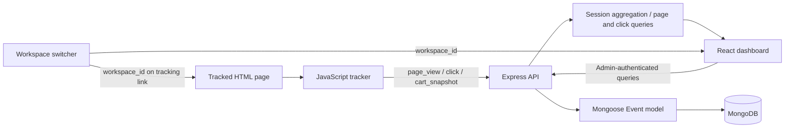

# TRACE Analytics

**A full-stack website interaction analytics application** built for the Full Stack Engineer assignment: capture browser activity, persist events in MongoDB, and explore sessions, user journeys, and click heatmaps in an admin dashboard.

[GitHub Repository](https://github.com/RICK2814/TRACE-ANALYTICS) · [Hosted Application](https://trace-analytics-one.vercel.app/)

> **Deployment note:** GitHub `main` is the source of truth. The hosted URL is an existing deployment and may not include the newest source changes until a deployment of the latest `main` revision completes.

---

## Table of Contents

- [Project Overview](#project-overview)
- [Assignment Requirements Coverage](#assignment-requirements-coverage)
- [Features](#features)
- [Architecture and Data Flow](#architecture-and-data-flow)
- [Technology Stack](#technology-stack)
- [Repository Structure](#repository-structure)
- [Getting Started Locally](#getting-started-locally)
- [Using the Application](#using-the-application)
- [Tracking Script Integration](#tracking-script-integration)
- [API Reference](#api-reference)
- [Event Data Model](#event-data-model)
- [Deployment on Vercel](#deployment-on-vercel)
- [Verification and Demo Checklist](#verification-and-demo-checklist)
- [Assumptions and Trade-offs](#assumptions-and-trade-offs)
- [Security and Privacy Notes](#security-and-privacy-notes)
- [Known Limitations](#known-limitations)

---

## Project Overview

TRACE Analytics demonstrates the core workflow of a lightweight product-analytics system:

1. A JavaScript tracker runs on a webpage and records page views and clicks.
2. Each event is sent to a Node.js/Express API with a browser session ID, page URL, timestamp, and (for clicks) page coordinates.
3. The backend validates and stores structured event documents in MongoDB through Mongoose.
4. An authenticated React dashboard queries the stored data and presents sessions, ordered event journeys, and click heatmaps.
5. Workspace selection can be used to separate analytics for different tracked sites or projects.

The repository includes a small outdoor-retail storefront to make the tracker easy to demonstrate. The storefront's pack and checkout are a **front-end demo**, not a live e-commerce service.

### Application links

| Route | Purpose |
|---|---|
| `/` | React analytics dashboard and Admin/User sign-in |
| `/demo.html` | Tracked storefront home page |
| `/demo2.html` | Tracked product collection page |
| `/checkout.html` | Demo cart and checkout flow |
| `/tracker.js` | Browser event-tracking script |
| `/health` | Backend health check |
| `/api/*` | Express API |

---

## Reviewer Login (Evaluation Demo)

Use the hosted application to review the Admin dashboard:

**Application:** [TRACE Analytics](https://trace-analytics-one.vercel.app/)

| Field | Evaluation value |
|---|---|
| Role | **Admin** |
| Username | `traceadmin` |
| Password | `Admin123` |

1. Open the application and select **Admin** on the sign-in screen.
2. Enter the credentials above and sign in.
3. Explore **Sessions**, **User Journey**, **Click heatmap**, and the workspace switcher.

**Important — demo access only:** These shared credentials are intentionally provided for assignment evaluation. Anyone who can read this public repository can see them, and Admin access includes visitor analytics and workspace management. Do not use this password for a personal account, real customer data, or a production system. Rotate the password after the review.

**Deployment status:** The Vercel Production environment variables have been set to the values above. Vercel requires a new deployment for environment-variable changes to take effect. If login is not yet accepted on the hosted URL, the current deployment may still be using the previously deployed environment; redeploy the latest `main` revision and then retry. Never add `ADMIN_PASSWORD`, `SESSION_SECRET`, or `MONGO_URI` to source code.

---

## Assignment Requirements Coverage

The implementation is mapped to the requirements in the *Build a Simple User Analytics Application* assignment.

| Assignment requirement | Implementation in TRACE Analytics |
|---|---|
| Client-side JavaScript tracker | `tracker/tracker.js`, served as `/tracker.js` |
| Track `page_view` events | Captured automatically when a tracked page loads |
| Track `click` events | Captures click coordinates and current document dimensions |
| Include session ID, event type, URL, and timestamp | Added to each event by the tracker |
| Send events to the backend | `POST /api/events` |
| Store events in MongoDB | Mongoose `Event` model |
| List sessions with event counts | `GET /api/sessions` and the dashboard Sessions view |
| Inspect events for a session in order | `GET /api/sessions/:id/events` and the User Journey panel |
| Fetch click data for a page | `GET /api/heatmap?url=...` |
| Visualize click positions | Click Heatmap view, with a tracked-page preview and click-intensity overlay |
| Provide setup steps, stack, assumptions/trade-offs | Documented throughout this README |
| Host the application and publish the source | Vercel deployment configuration and public GitHub repository |

**Additional capabilities beyond the assignment's core scope:** Admin/User authentication, workspace-aware analytics, a tracked demo storefront, and checkout cart snapshots. These are demo features; the payment flow does not process real payments.

---

## Features

### Analytics dashboard

- **Sessions:** review recorded sessions with event and click counts.
- **User journey:** select a session to inspect its events chronologically.
- **Click heatmap:** select a page URL and visualize recorded click positions over a page preview.
- **Page selector:** lists tracked pages that have page-view or click records, including pages that have not yet accumulated clicks.
- **Refresh:** session data refreshes automatically; the heatmap page list and click positions refresh while the view is open.
- **Role filters:** on supported newer events, inspect all activity, Users only, Admin only, or signed-out/guest activity.
- **Checkout activity:** for new cart snapshots, review product names, quantities, estimated subtotal, role, and time of activity without capturing delivery addresses or payment credentials.

### Workspaces

- Create multiple named workspaces from the dashboard's workspace switcher; the application does not impose a fixed workspace-count limit.
- Switch workspaces to scope Sessions, page lists, click data, and checkout activity.
- Each workspace has a unique ID stored with new tracked events.
- Use **Copy tracking link** in the workspace menu to share a demo URL that assigns the visitor's activity to the selected workspace.
- Existing events without a workspace ID remain visible in the default **Trace workspace** for backward compatibility.

Actual capacity is subject to MongoDB storage, deployment resources, and service limits.

### Authentication and access

- Admin credentials are configured through backend environment variables.
- Users can register and sign in to use the tracked storefront.
- Analytics read endpoints and workspace management APIs require Admin authentication.
- The tracker event-write endpoint remains publicly reachable so it can record activity from visitors who are not logged in. Visitor role and username, when available, are derived server-side from the signed session cookie.
- The demo account control shows Sign in or Sign out in a dropdown.

### Demo storefront

- Two responsive HTML storefront pages with a shared tracking script.
- Product data and cart quantities are stored in browser `localStorage`.
- Checkout supports quantity edits, item removal, sample delivery calculations, and a simulated order confirmation.
- Sample prices are displayed in Indian rupees (INR).

---

## Architecture and Data Flow



### Main components

| Component | Responsibility |
|---|---|
| Browser tracker | Creates/reuses a session ID, records events, and posts JSON to the API |
| Express backend | Validates event payloads, enforces read access, exposes analytics/auth/workspace endpoints |
| MongoDB | Stores event records, registered users, and workspace metadata |
| React + Vite dashboard | Displays session summaries, chronological journeys, heatmaps, filters, and workspace controls |
| Demo storefront | Provides public pages on which to test tracking and checkout activity |
| Vercel Services | Routes the frontend and backend under one application URL |

---

## Technology Stack

| Layer | Technology |
|---|---|
| Client-side tracker | Vanilla JavaScript, Browser APIs, `localStorage`, Fetch API |
| Dashboard | React 18, Vite 5, JavaScript, CSS |
| Backend | Node.js, Express 4 |
| Data access | Mongoose 8 |
| Database | MongoDB / MongoDB Atlas |
| Authentication | Signed HttpOnly session cookie, Node.js crypto, password hashing with scrypt |
| Hosting | Vercel multi-service project |
| Demo storefront | HTML, CSS, JavaScript |

---

## Repository Structure

```text
TRACE-ANALYTICS/
├── dashboard/
│   ├── public/
│   │   ├── demo.html             # Tracked storefront home
│   │   ├── demo2.html            # Product collection page
│   │   ├── checkout.html         # Demo cart and checkout
│   │   ├── tracker.js            # Static copy of the tracker
│   │   └── session-ui.js         # Shared account dropdown
│   ├── src/
│   │   ├── App.jsx               # Authentication and dashboard shell
│   │   ├── Sessions.jsx          # Session list and user journey
│   │   ├── Heatmap.jsx           # Page selector and click overlay
│   │   ├── api.js                # Dashboard API client
│   │   ├── main.jsx              # React entry point
│   │   └── styles.css            # Dashboard styles
│   ├── .env.example              # Frontend API URL
│   └── package.json
├── server/
│   ├── middleware/
│   │   └── adminAuth.js          # Signed-session and access middleware
│   ├── models/
│   │   ├── Event.js              # Analytics event schema
│   │   ├── User.js               # Registered user schema
│   │   └── Workspace.js          # Workspace metadata
│   ├── routes/
│   │   ├── auth.js               # Login, registration, logout, session info
│   │   ├── events.js             # Event ingestion and analytics APIs
│   │   └── workspaces.js         # Workspace list and creation
│   ├── db.js                     # MongoDB connection
│   ├── index.js                  # Express application
│   ├── .env.example              # Backend configuration template
│   └── package.json
├── tracker/
│   ├── tracker.js                # Reusable browser event tracker
│   ├── demo.html                 # Local demo home
│   ├── demo2.html                # Local collection page
│   ├── checkout.html             # Local demo checkout
│   ├── site.js                   # Storefront/cart interactions
│   ├── site.css                  # Storefront styles
│   └── session-ui.js              # Account dropdown behavior
├── vercel.json                   # Multi-service routing configuration
└── README.md
```

The static storefront and tracker files are mirrored under `tracker/` and `dashboard/public/`: use `tracker/` for the local demo server and `dashboard/public/` for the deployed static pages. Keep both copies synchronized when editing shared storefront behavior.

---

## Getting Started Locally

### Prerequisites

- Node.js 18 or later and npm.
- A MongoDB instance: local MongoDB or a MongoDB Atlas cluster.
- Git.
- Three terminal windows for the backend, demo site, and dashboard.

### 1. Clone the repository

```bash
git clone https://github.com/RICK2814/TRACE-ANALYTICS.git
cd TRACE-ANALYTICS
```

### 2. Configure the backend

Create the backend environment file from the example.

**macOS/Linux**
```bash
cd server
npm install
cp .env.example .env
```

**Windows PowerShell**
```powershell
cd server
npm install
Copy-Item .env.example .env
```

Edit `server/.env`:

```dotenv
MONGO_URI=mongodb://127.0.0.1:27017/analytics
PORT=4000
CORS_ORIGIN=*
ADMIN_USERNAME=traceadmin
ADMIN_PASSWORD=replace-with-a-strong-unique-password
SESSION_SECRET=replace-with-at-least-32-random-characters
```

- Set `MONGO_URI` to your local MongoDB URI or Atlas connection string.
- Replace the sample Admin username/password.
- Set `SESSION_SECRET` to a cryptographically random secret of at least 32 characters.
- Do not commit your real `.env` file or disclose the database URI.

Start the API:

```bash
npm start
```

The API runs at `http://localhost:4000` unless `PORT` is changed. Keep this terminal open.

### 3. Run the tracked demo site

In a second terminal, return to the repository root and start a static server:

```bash
npx serve tracker -l 3000
```

Open [http://localhost:3000/demo.html](http://localhost:3000/demo.html). Visit the product collection and checkout pages, click links or buttons, and add/remove products to generate activity.

### 4. Configure and run the React dashboard

In a third terminal:

**macOS/Linux**
```bash
cd dashboard
npm install
cp .env.example .env
npm run dev
```

**Windows PowerShell**
```powershell
cd dashboard
npm install
Copy-Item .env.example .env
npm run dev
```

The frontend template sets:

```dotenv
VITE_API=http://localhost:4000/api
```

Open the Vite URL printed in the terminal, normally [http://localhost:5173](http://localhost:5173). Sign in as Admin using the backend environment credentials. Register or sign in as a User to visit the tracked storefront.

### 5. Check that tracking works

1. Sign in as Admin in the dashboard.
2. Open the demo site in another tab and interact with it.
3. In browser Developer Tools, open **Network** and filter for `events`.
4. Confirm the `POST /api/events` request returns HTTP `201`.
5. Return to Sessions or Click heatmap and refresh if required.
6. For database verification, open `/api/db-status` in the authenticated Admin browser or inspect the `events` collection in MongoDB.

---

## Using the Application

### Admin flow

1. Visit `/` and choose **Admin**.
2. Sign in using `ADMIN_USERNAME` and `ADMIN_PASSWORD`.
3. Use **Sessions** to inspect session counts and event totals.
4. Select a session to view its ordered event journey.
5. Switch to **Click heatmap**, choose a tracked page, and use the role filter where data is available.
6. Use the workspace switcher to create or select a workspace.
7. Copy the tracking link for that workspace and use it for new visits you want grouped together.

### User flow

1. Visit `/` and select **User**.
2. Sign in, or create a User account.
3. The application sends the User to `/demo.html`.
4. Navigate through the storefront and checkout. Events are attributed to the current signed-in role when the browser sends the tracker request.

### Workspace behavior

- Workspace creation is available to authenticated Admins.
- Names must be 2–60 characters and unique per Admin account.
- Workspace selection is stored in the dashboard browser; tracked links pass a workspace ID to the demo and the tracker persists it for same-origin navigation.
- Events from earlier versions without a workspace ID remain in the default workspace.
- Workspace IDs are analytics grouping keys, not separate database clusters or billing accounts.

---

## Tracking Script Integration

For a page served from the same application origin, include the tracker script before the closing body tag:

```html
<script src="/tracker.js" data-api="/api/events"></script>
```

The tracker automatically sends:
- `page_view` on page load.
- `click` when the visitor clicks anywhere on the page.
- A session ID reused from `localStorage` and renewed after 30 minutes of inactivity.
- The current URL and client timestamp.
- Click `x`/`y` coordinates and page width/height for scaling the heatmap.
- A `workspace_id` when a workspace-specific tracking link has been used.

The checkout page also emits a `cart_snapshot` event when cart contents are viewed or changed and when the demo order is submitted. These snapshots contain product names, prices, quantities, and the calculated subtotal, not delivery form data or payment credentials.

For a separately hosted site, configure `data-api` to point to an accessible API endpoint and configure backend CORS accordingly. A standalone external site may need an explicit allowlist instead of the local-development CORS setting.

---

## API Reference

All endpoints are relative to the application origin. In local development, the API base URL is `http://localhost:4000/api`.

### Analytics and event ingestion

| Method | Endpoint | Access | Description |
|---|---|---|---|
| `POST` | `/api/events` | Public write | Store a single event or an array of up to 100 events |
| `GET` | `/api/sessions` | Admin | Session IDs, total event counts, click counts, and first/last activity |
| `GET` | `/api/sessions/:id/events` | Admin | Chronologically ordered page-view/click events for a session |
| `GET` | `/api/pages` | Admin | Pages grouped for the heatmap selector with click and page-view counts |
| `GET` | `/api/heatmap?url=...` | Admin | Click coordinates for a selected page |
| `GET` | `/api/checkout-activity` | Admin | Latest stored cart snapshot per session, with optional role filter |
| `GET` | `/api/db-status` | Admin | MongoDB connection state, collection name, and event count |
| `GET` | `/health` | Public | Lightweight API health check |

Analytics query endpoints accept `workspace_id` to scope results to a workspace. If it is omitted, the default workspace is used; records from older versions that do not contain a workspace ID are also included in the default workspace.

Common query parameters:

| Parameter | Applies to | Purpose |
|---|---|---|
| `workspace_id` | Analytics endpoints | Select workspace scope |
| `limit`, `skip` | `/api/sessions` | Control session result count and offset; maximum limit is capped by the API |
| `url` | `/api/heatmap` | Select a page URL or path |
| `role` | `/api/heatmap`, `/api/checkout-activity` | `all`, `user`, `admin`, or `guest` |

Examples:

```text
GET /api/sessions?workspace_id=default&limit=100&skip=0
GET /api/sessions/<session-id>/events?workspace_id=default
GET /api/pages?workspace_id=default
GET /api/heatmap?url=%2Fcheckout.html&role=user&workspace_id=default
GET /api/checkout-activity?role=user&workspace_id=default
```

A successful event-write request returns HTTP `201` and a JSON body such as:

```json
{ "stored": 1 }
```

### Workspaces

| Method | Endpoint | Access | Description |
|---|---|---|---|
| `GET` | `/api/workspaces` | Admin | List the Admin's workspaces and the default workspace |
| `POST` | `/api/workspaces` | Admin | Create a workspace |

Create a workspace:

```http
POST /api/workspaces
Content-Type: application/json

{
  "name": "Marketing website"
}
```

Workspace creation returns HTTP `201` and a workspace object containing an ID, name, default-workspace flag, and creation timestamp. A duplicate name for the same Admin returns HTTP `409`. The application has no configured fixed workspace-count limit.

### Authentication

| Method | Endpoint | Description |
|---|---|---|
| `GET` | `/api/auth/me` | Check current authentication state and role |
| `POST` | `/api/auth/register` | Register a User account |
| `POST` | `/api/auth/login` | Sign in as Admin or User |
| `POST` | `/api/auth/logout` | Expire the current session cookie |

Login accepts a JSON body with `username`, `password`, and `role` (`admin` or `user`). User registration accepts a username and password. Passwords for registered Users are hashed with Node.js scrypt; the Admin password is provided through the backend environment.

### Event payloads

A typical click event:

```json
{
  "session_id": "session-uuid",
  "type": "click",
  "url": "https://example.com/product",
  "timestamp": "2026-10-12T12:00:00.000Z",
  "x": 320,
  "y": 740,
  "page_w": 1280,
  "page_h": 2400,
  "workspace_id": "default"
}
```

A page view uses the same core fields, without click coordinates:

```json
{
  "session_id": "session-uuid",
  "type": "page_view",
  "url": "https://example.com/product",
  "timestamp": "2026-10-12T12:00:00.000Z",
  "workspace_id": "default"
}
```

For the demo's checkout snapshots, `type` is `cart_snapshot`; `cart_items` contains product `name`, `price`, and `quantity`, and the backend calculates `cart_total`. The server derives `role` and `username` from the signed session cookie rather than trusting client-supplied values.

---

## Event Data Model

The `Event` Mongoose model stores structured documents in MongoDB. Depending on the event type, the document can contain:

| Field | Type / purpose |
|---|---|
| `session_id` | Browser session identifier |
| `type` | `page_view`, `click`, or `cart_snapshot` |
| `url` | Page URL recorded by the tracker |
| `timestamp` | Client event timestamp |
| `receivedAt` | Server-side receipt timestamp |
| `workspace_id` | Workspace grouping key; older events may not have one |
| `role`, `username` | Visitor identity derived from a valid session, or `guest` when signed out |
| `x`, `y` | Click coordinates |
| `page_w`, `page_h` | Page dimensions at click time |
| `cart_items` | Product name, price, and quantity for checkout snapshots |
| `cart_total`, `cart_stage` | Estimated subtotal and snapshot stage |

The backend indexes session/time, type/URL, and event timestamp to support common queries.

---

## Deployment on Vercel

The repository-root `vercel.json` defines a Vercel multi-service application:

- **Dashboard service:** the Vite/React frontend and static demo pages.
- **Backend service:** the Express API and MongoDB connection.
- **Shared domain:** `/api/*` and `/health` route to the backend; other routes route to the dashboard service.
- **Database:** MongoDB Atlas, accessed by the backend only.

### Deployment steps

1. Import [RICK2814/TRACE-ANALYTICS](https://github.com/RICK2814/TRACE-ANALYTICS) into [Vercel](https://vercel.com/new).
2. Deploy from the repository root as a **multi-service project**. Do not import only `dashboard/` or `server/` as an independent project.
3. Configure the following variables in the backend service:
   - `MONGO_URI`
   - `ADMIN_USERNAME`
   - `ADMIN_PASSWORD`
   - `SESSION_SECRET` (random, at least 32 characters)
   - Optional: `PORT`, `CORS_ORIGIN`
4. Confirm MongoDB Atlas network access and database-user permissions allow the backend to connect.
5. Deploy and verify `/health` returns `{"ok":true}`.
6. Sign in as Admin, record a test visit on `/demo.html`, and confirm new activity appears in Sessions and Click heatmap.
7. Use `/api/db-status` while authenticated as Admin to verify the database connection and event count.

Never commit secrets into source control. Set environment values in the Vercel backend service's environment-variable settings.

---

## Verification and Demo Checklist

Use this checklist before presenting the assignment:

- [ ] API starts and `/health` returns `{"ok":true}`.
- [ ] MongoDB is reachable and the `events` collection is created after the first event.
- [ ] A tracked page view creates a `page_view` event.
- [ ] Clicking a page creates a `click` event containing `x`, `y`, `page_w`, and `page_h`.
- [ ] `POST /api/events` returns HTTP `201` for a valid event.
- [ ] The Admin dashboard lists sessions and shows event totals.
- [ ] Selecting a session shows the ordered user journey.
- [ ] Selecting a URL in Click heatmap draws the recorded click intensity.
- [ ] Admin/User access is behaving as expected.
- [ ] Creating and switching workspaces scopes newly tracked events and analytics queries.
- [ ] The checkout demo displays product/quantity/subtotal snapshots while keeping delivery/payment details out of MongoDB.
- [ ] Vercel environment variables are set and the latest intended source revision has deployed.

For database evidence during a technical review, show the tracked page, the `POST /api/events` request in Developer Tools, the MongoDB `events` collection, and the corresponding dashboard results—in that order.

---

## Assumptions and Trade-offs

- **Session lifecycle:** a session ID is kept in browser `localStorage` and renewed after 30 minutes of inactivity. It is a lightweight analytics session identifier, not an authenticated account ID.
- **Event time:** event ordering uses the client timestamp. The server also stores `receivedAt` for diagnostics.
- **Heatmap coordinates:** click coordinates are stored together with page dimensions and scaled to the dashboard preview. If a page reflows at a different viewport size, visual positions are approximate rather than pixel-perfect.
- **Iframe preview:** the selected page is displayed in an iframe. An external page that disallows framing cannot be shown behind the heatmap; the overlay can be used with the page background hidden.
- **Session aggregation:** session summaries are computed from the event collection at query time. A much larger deployment could pre-aggregate session summaries.
- **Event delivery:** the tracker sends events individually with Fetch `keepalive`. Batching could reduce request volume at higher traffic.
- **Workspaces:** events are grouped by a workspace ID. The default workspace includes legacy events. Workspace count is not hard-capped by application logic, but storage and deployment capacity are finite.
- **Demo checkout:** cart state and the demo receipt use browser `localStorage`. The checkout does not create a real order or charge money.
- **Existing role metadata:** role and username can only be shown for events recorded after role-aware tracking is enabled. Older records without identity metadata cannot be reliably assigned a role retroactively.
- **Testing:** the repository's package scripts provide development/build commands; the verification checklist above describes manual functional checks.

---

## Security and Privacy Notes

- Keep `MONGO_URI`, `ADMIN_PASSWORD`, and `SESSION_SECRET` private. Use strong, unique production values.
- Session cookies are signed, HttpOnly, and configured with SameSite protection; production cookies use Secure.
- Login/registration attempts are rate limited. Event writes have a request-rate limit and JSON body-size limit.
- Analytics reads and workspace management are Admin-only. Public event ingestion is intentional so unauthenticated visitors can be tracked; this endpoint can still receive untrusted input and should be monitored in production.
- The demo checkout does not send delivery address details to the analytics API and does not collect card or bank credentials.
- This project is an assignment/demo analytics application, not a compliance-certified analytics product. For real customer data, add an appropriate consent/retention policy, data deletion controls, stricter ingestion abuse protection, monitoring, and a documented privacy notice.

---

## Known Limitations

- Heatmap alignment is approximate on responsive pages or pages with changing layout.
- Data arrives asynchronously; an event that has not reached the API/MongoDB cannot appear in the dashboard.
- Existing data from older tracker versions may not include workspace, role, username, or cart fields.
- The demo checkout is not connected to a payment gateway, order-management system, inventory, or shipping provider.
- The number of workspaces and stored events is practically limited by the MongoDB plan and hosting resources, even though the application does not enforce a fixed workspace-count limit.

---

**Assignment project:** TRACE Analytics · **Primary stack:** React, Node.js/Express, MongoDB · **Source:** [RICK2814/TRACE-ANALYTICS](https://github.com/RICK2814/TRACE-ANALYTICS)
