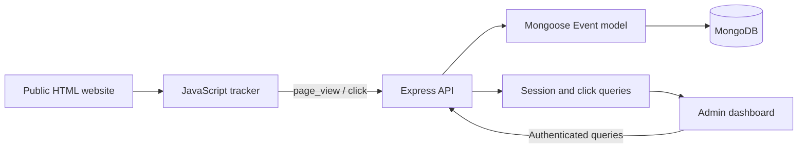

# TRACE Analytics

**Full-stack website interaction analytics for the Full Stack Engineer assignment.** TRACE Analytics captures browser page views and clicks, stores events in MongoDB, and presents session activity, user journeys, and click heatmaps through an authenticated dashboard.

**Live HTML Website:** [Open the website](https://trace-analytics-one.vercel.app/demo.html)  
**Source Code:** [RICK2814/TRACE-ANALYTICS](https://github.com/RICK2814/TRACE-ANALYTICS)

> The linked HTML page above is the single public website showcased in this README. The dashboard and API support the assignment behind the scenes. GitHub `main` is the source of truth; the live deployment may not contain every newest source change until Vercel deploys it.

---

## Contents

- [Overview](#overview)
- [Assignment Requirements Coverage](#assignment-requirements-coverage)
- [Core Features](#core-features)
- [Architecture and Data Flow](#architecture-and-data-flow)
- [Technology Stack](#technology-stack)
- [Repository Structure](#repository-structure)
- [Local Setup](#local-setup)
- [Reviewer Access](#reviewer-access)
- [Tracking Script](#tracking-script)
- [API Reference](#api-reference)
- [Event Data Model](#event-data-model)
- [Deployment](#deployment)
- [Verification Checklist](#verification-checklist)
- [Assumptions and Trade-offs](#assumptions-and-trade-offs)
- [Security and Limitations](#security-and-limitations)

---

## Overview

The application follows a simple analytics pipeline:

1. A browser-side JavaScript tracker observes page views and clicks on the linked HTML website.
2. Each event includes a session identifier, event type, page URL, timestamp, and click coordinates when relevant.
3. The Node.js/Express backend validates incoming events and saves structured records through Mongoose.
4. MongoDB stores events for querying.
5. An Admin-authenticated React dashboard presents session totals, chronological user journeys, and a click heatmap.

The HTML website is the visitor-facing tracking surface. The dashboard is the reviewer/admin interface for inspecting the activity collected from that page.

---

## Assignment Requirements Coverage

| Assignment requirement | Implementation |
|---|---|
| JavaScript tracking script | Reusable browser tracker in `tracker/tracker.js`, served as `/tracker.js` |
| Track `page_view` events | Generated on tracked page load |
| Track `click` events | Captures click coordinates and document dimensions |
| Include session ID, event type, URL, timestamp | Attached to each tracking event |
| Send event data to the backend | `POST /api/events` |
| Store structured records in MongoDB | Mongoose `Event` model |
| List sessions with event counts | `GET /api/sessions` |
| Show a selected session's ordered events | `GET /api/sessions/:id/events` and User Journey view |
| Fetch page click data | `GET /api/heatmap?url=...` |
| Visualize click positions | React Click heatmap view |
| Document setup, stack, assumptions and trade-offs | Covered in this README |
| Host the project and share its source | Vercel configuration and public GitHub repository |

---

## Core Features

### Browser event tracking
- Tracks page views and click interactions on the HTML website.
- Reuses a browser session ID and renews it after a period of inactivity.
- Captures page URL and event time; click events also include coordinate and page-size metadata.
- Sends event data asynchronously to the backend.

### Analytics dashboard
- **Sessions:** see recorded sessions with total event and click counts.
- **User Journey:** inspect one session's events in chronological order.
- **Click heatmap:** select a tracked page and visualize where clicks occurred.
- **Page selector:** discover pages with tracked page views or clicks.
- **Role filtering:** on supported newer events, filter by all activity, User, Admin, or guest.
- **Workspace switcher:** create and switch among workspaces to keep analytics datasets separate. Workspace capacity depends on database and hosting resources rather than a fixed application count limit.

### Access control
- Admin authentication protects analytics read endpoints and workspace management.
- User accounts are intended for interacting with the public HTML website, not for reading analytics data.
- The event-write endpoint is public by design so visitors can be tracked even when not authenticated.

---

## Architecture and Data Flow



| Component | Responsibility |
|---|---|
| HTML website | Provides the page where visitor activity is captured |
| Browser tracker | Creates/reuses session IDs and submits event payloads |
| Express backend | Validates event writes and exposes analytics APIs |
| MongoDB | Persists structured event records |
| React + Vite dashboard | Presents sessions, user journeys and click heatmaps |
| Vercel | Hosts the dashboard/site and routes API requests to the backend |

---

## Technology Stack

| Layer | Technology |
|---|---|
| Public website and tracker | HTML, CSS, vanilla JavaScript, Fetch API |
| Dashboard | React 18, Vite 5, JavaScript |
| Backend | Node.js, Express 4 |
| Database integration | Mongoose 8 |
| Database | MongoDB / MongoDB Atlas |
| Authentication | Signed HttpOnly session cookie; Node.js crypto and scrypt |
| Hosting | Vercel multi-service configuration |

---

## Repository Structure

```text
TRACE-ANALYTICS/
├── dashboard/
│   ├── public/
│   │   ├── demo.html          # The public HTML page showcased above
│   │   ├── tracker.js         # Browser event tracker
│   │   ├── session-ui.js      # Account dropdown behavior
│   │   ├── site.css           # Public website styles
│   │   └── site.js            # Public website interactions
│   └── src/
│       ├── App.jsx            # Authentication and dashboard shell
│       ├── Sessions.jsx       # Sessions and user journey
│       ├── Heatmap.jsx        # Click heatmap
│       ├── api.js             # Dashboard API client
│       └── styles.css         # Dashboard styles
├── server/
│   ├── middleware/
│   │   └── adminAuth.js       # Signed-session and Admin access checks
│   ├── models/
│   │   ├── Event.js           # Event schema
│   │   ├── User.js            # Registered user schema
│   │   └── Workspace.js       # Workspace schema
│   ├── routes/
│   │   ├── auth.js            # Login, registration and logout
│   │   ├── events.js          # Event ingestion and analytics APIs
│   │   └── workspaces.js      # Workspace list and creation
│   ├── db.js                  # MongoDB connection
│   └── index.js               # Express application
├── tracker/
│   ├── demo.html              # Local source copy of the public HTML page
│   ├── tracker.js             # Reusable tracker source
│   ├── site.css               # Public website styles
│   ├── site.js                # Public website interactions
│   └── session-ui.js           # Account UI
├── vercel.json                # Multi-service routing
└── README.md
```

The tracker and public site assets are mirrored between `tracker/` and `dashboard/public/` for local testing and deployment. Keep these copies synchronized when editing shared behavior.

---

## Local Setup

### Prerequisites
- Node.js 18 or later and npm
- A MongoDB instance (local MongoDB or MongoDB Atlas)
- Git

### 1. Clone the repository

```bash
git clone https://github.com/RICK2814/TRACE-ANALYTICS.git
cd TRACE-ANALYTICS
```

### 2. Configure and start the backend

```bash
cd server
npm install
```

Copy `.env.example` to `.env` (on Windows PowerShell, use `Copy-Item .env.example .env`) and set the required values:

```dotenv
MONGO_URI=mongodb://127.0.0.1:27017/analytics
PORT=4000
CORS_ORIGIN=*
ADMIN_USERNAME=traceadmin
ADMIN_PASSWORD=change-this-demo-password
SESSION_SECRET=replace-with-a-random-secret-of-at-least-32-characters
```

Replace sample credentials and use a random session secret of at least 32 characters. Never commit the real `.env` file.

Start the server:

```bash
npm start
```

### 3. Run the public HTML website locally

Open a second terminal at the repository root and serve the `tracker` directory:

```bash
npx serve tracker
```

Use the local address printed by the static server and open the `demo.html` page. Interact with the page to generate tracking events.

### 4. Start the React dashboard

Open a third terminal:

```bash
cd dashboard
npm install
```

Copy `.env.example` to `.env` and confirm the API URL is configured:

```dotenv
VITE_API=http://localhost:4000/api
```

Then run:

```bash
npm run dev
```

Open the Vite URL printed in the terminal and sign in as Admin.

---

## Reviewer Access

The following credentials are published for assignment evaluation only.

| Field | Value |
|---|---|
| Website | Use the **Live HTML Website** link at the top of this README |
| Role | Admin |
| Username | `traceadmin` |
| Password | `Admin123` |

Open the linked HTML website, click its **Account** control, choose **Sign in to TRACE**, then select the Admin role and enter the credentials.

**Security warning:** this is a shared demo account. Anyone who can read the public repository can see these credentials. Do not use them with real customer data or a production service, and rotate the password after evaluation.

The Vercel Production environment variables were updated, but a new deployment is required for environment-variable changes to take effect. If login does not accept these credentials, the live deployment may still be using its previous environment configuration.

---

## Tracking Script

The tracking script is served at `/tracker.js`. For a page served from the same application origin, add:

```html
<script src="/tracker.js" data-api="/api/events"></script>
```

The tracker sends:
- `page_view` on load
- `click` on user interaction
- A session identifier, page URL and timestamp
- Click `x`/`y` coordinates and document dimensions for heatmap scaling

A session ID is stored in browser `localStorage` and renewed after 30 minutes of inactivity. For a separately hosted site, point `data-api` at the reachable API endpoint and configure backend CORS for the origin.

---

## API Reference

All listed API paths use the application origin. Locally, the backend API base is configured as `http://localhost:4000/api`.

### Analytics

| Method | Endpoint | Access | Purpose |
|---|---|---|---|
| `POST` | `/api/events` | Public write | Store one event or an array of events |
| `GET` | `/api/sessions` | Admin | Return sessions with event/click totals |
| `GET` | `/api/sessions/:id/events` | Admin | Return one session's events in time order |
| `GET` | `/api/pages` | Admin | Return pages and their view/click counts |
| `GET` | `/api/heatmap?url=...` | Admin | Return click coordinates for a selected page |
| `GET` | `/api/db-status` | Admin | Report MongoDB connection status and event count |
| `GET` | `/health` | Public | Check that the API process responds |

Analytics reads support the `workspace_id` parameter. When it is omitted, the default workspace is used; legacy events without a workspace ID remain visible in that default workspace.

### Workspace management

| Method | Endpoint | Access | Purpose |
|---|---|---|---|
| `GET` | `/api/workspaces` | Admin | List available workspaces |
| `POST` | `/api/workspaces` | Admin | Create a workspace |

Example request:

```http
POST /api/workspaces
Content-Type: application/json

{
  "name": "Marketing analytics"
}
```

Workspace names must be 2–60 characters and unique for the same Admin account. No fixed workspace-count limit is imposed by application logic.

### Authentication

| Method | Endpoint | Purpose |
|---|---|---|
| `GET` | `/api/auth/me` | Read current sign-in state |
| `POST` | `/api/auth/register` | Register a User account |
| `POST` | `/api/auth/login` | Sign in as Admin or User |
| `POST` | `/api/auth/logout` | End the current session |

### Example event payload

```json
{
  "session_id": "session-uuid",
  "type": "click",
  "url": "https://example.com/page",
  "timestamp": "2026-10-12T12:00:00.000Z",
  "x": 320,
  "y": 740,
  "page_w": 1280,
  "page_h": 2400,
  "workspace_id": "default"
}
```

For `page_view` events, click coordinates are not required. Visitor role and username, when available, are derived on the server from the signed session cookie rather than trusted from the client payload.

---

## Event Data Model

The Mongoose `Event` model stores structured documents in MongoDB.

| Field | Purpose |
|---|---|
| `session_id` | Browser session identifier |
| `type` | Event type, including `page_view` and `click` |
| `url` | Page URL captured by the tracker |
| `timestamp` | Client event timestamp |
| `receivedAt` | Server-side receipt time |
| `workspace_id` | Workspace grouping key; absent on some older records |
| `role`, `username` | Visitor role/name where the server can resolve a signed-in session |
| `x`, `y` | Click coordinates |
| `page_w`, `page_h` | Page dimensions when the click occurred |

Indexes support common session/time and page/type lookups.

---

## Deployment

The repository-root `vercel.json` configures a multi-service deployment:

- The dashboard service serves the React application and public HTML page.
- The backend service hosts the Express API.
- Requests to `/api/*` and `/health` are routed to the backend; other paths are routed to the dashboard service.
- MongoDB Atlas is managed separately and accessed by the backend.

### Deployment steps

1. Import [RICK2814/TRACE-ANALYTICS](https://github.com/RICK2814/TRACE-ANALYTICS) in Vercel.
2. Deploy from the repository root as a multi-service project; do not deploy only the `dashboard/` or `server/` directory.
3. Configure backend environment variables: `MONGO_URI`, `ADMIN_USERNAME`, `ADMIN_PASSWORD`, and `SESSION_SECRET`.
4. Verify the database network access and credentials in MongoDB Atlas.
5. Deploy, then check that `/health` returns `{"ok":true}`.
6. Use the Live HTML Website link at the top of this README to generate some activity and inspect the Admin dashboard.

Do not store real secrets in GitHub. Configure them only in the deployment environment.

---

## Verification Checklist

- [ ] Backend starts and `/health` returns `{"ok":true}`.
- [ ] MongoDB is reachable from the backend.
- [ ] Loading the HTML website stores a `page_view` event.
- [ ] Clicking the page stores a `click` event with coordinate and document-size fields.
- [ ] A valid `POST /api/events` request returns HTTP `201`.
- [ ] The Admin dashboard displays sessions and event totals.
- [ ] Selecting a session displays its ordered user journey.
- [ ] The Click heatmap renders recorded click intensity for a selected page.
- [ ] Workspace creation and switching scope analytics queries correctly.
- [ ] The live deployment uses the intended environment variables and source revision.

For a technical review, demonstrate the HTML page, a successful event POST in browser Developer Tools, the stored event in MongoDB, and the corresponding dashboard result.

---

## Assumptions and Trade-offs

- **Session lifecycle:** a browser session ID is kept in `localStorage` and renewed after 30 minutes of inactivity. It is an analytics identifier, not an authenticated account ID.
- **Event time:** ordering uses the client timestamp; the server also stores `receivedAt` for diagnostics.
- **Heatmap coordinates:** the dashboard scales stored click coordinates using captured page dimensions. Responsive layout changes can make alignment approximate rather than pixel-perfect.
- **Page preview:** the selected page is displayed in an iframe; external pages that disallow framing cannot be shown behind the heatmap.
- **Session aggregation:** session summaries are queried from the event collection. Very large deployments may benefit from pre-aggregated summaries.
- **Event delivery:** events are sent individually with Fetch `keepalive`; batching could reduce request volume at higher traffic.
- **Workspaces:** a workspace ID scopes analytics records. Legacy events without a workspace ID remain in the default workspace.
- **Identity metadata:** only newer events can be reliably filtered by visitor role and username when that metadata was recorded. Old records cannot be assigned missing identity data retroactively.

---

## Security and Limitations

- Keep `MONGO_URI`, `ADMIN_PASSWORD`, and `SESSION_SECRET` private outside this assignment demo.
- Session cookies are signed and HttpOnly, with SameSite protection; production cookies use Secure.
- Login attempts and event ingestion are rate limited. Event request bodies are size-capped.
- Event ingestion is public by design so signed-out visitors can be tracked; untrusted input and abuse still need monitoring for a production-grade service.
- This project is an assignment/demo application, not a compliance-certified analytics product. A real deployment should add suitable consent and retention policies, data deletion controls, monitoring, and a clear privacy notice.
- Workspace count and event storage are practically limited by MongoDB and hosting capacity, even though the application does not enforce a fixed workspace-count limit.

---

**Project:** TRACE Analytics · **Stack:** React, Node.js/Express, MongoDB · **Purpose:** Full Stack Engineer assignment
